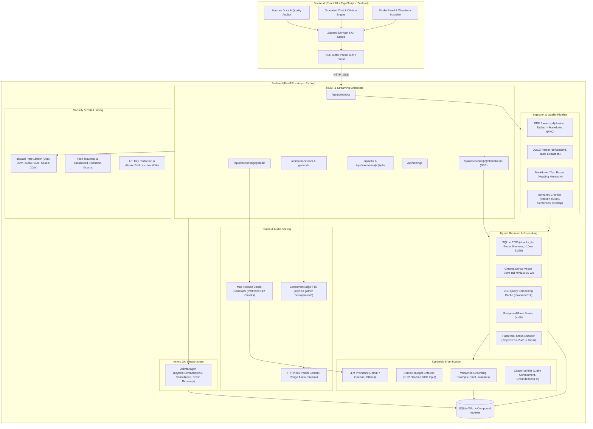

# NotebookLM-lite

> **A scholarly, local-first research notebook featuring dense-sparse hybrid search, native SQLite FTS5 retrieval, cross-encoder re-ranking, verifiable inline citations, Map-Reduce studio synthesis, and concurrent two-host audio overviews.**

NotebookLM-lite is an open-source, local-first alternative to Google NotebookLM. Built with Python (FastAPI + SQLAlchemy 2.0 + SQLite WAL) and React 18 (TypeScript + Zustand), it prioritizes **strict factual grounding**, verifiable evidence links, and multi-document synthesis across local corpora with zero cloud lock-in.

The application features a bespoke **"paper & ink"** scholarly aesthetic: warm dark ink (`#0C0C0B`) and tactile paper white (`#F4F0E4`), serif display typography (`Instrument Serif`), monospace metadata (`JetBrains Mono`), 1px hairline rules, a single chartreuse accent (`#D6FF3F`), and exactly two raised structural surfaces (`Composer` and `Audio Player`).

---

## Architecture Overview



---

## 9-Phase Engineering Re-Architecture

NotebookLM-lite has been re-architected from the ground up across 9 rigorous engineering phases:

| Phase | Milestone | Key Architectural Deliverables | Test Coverage |
|---|---|---|---|
| **Phase 0** | **Recon & Skill Audit** | Full codebase & dependency audit; identification of 4 critical STOP-THE-LINE security risks; skill application matrix across 45 agent skills. | Verified |
| **Phase 1** | **Safety Net & Baselines** | STOP-THE-LINE security fixes (API key masking, atomic `.env` locks, header authentication, path traversal isolation); structured JSON telemetry; versioned prompts; characterization tests; OpenAPI breaking change guard; Golden Evaluation matrix. | 34 Pytest |
| **Phase 2** | **Async Core & Job Infra** | `core/jobs/manager.py` with `asyncio.Semaphore(2)`, cooperative cancellation (`task.cancel()`), startup crash recovery; additive job polling endpoints (`GET /api/jobs/{id}`, `POST /api/jobs/{id}/cancel`); client disconnect detection in chat streams; compound SQLite indexes (`source_id + chunk_index`, `thread_id + created_at`). | 2 Pytest |
| **Phase 3** | **Ingestion & Chunking** | `pdfplumber` layout-aware parsing with tabular grid-to-Markdown conversion; `defusedxml` entity-expansion defense; heading hierarchy depth tracking; `tiktoken` (`cl100k_base`) sentence-boundary semantic chunker with normalized char/byte offsets and SHA-256 chunk hashes. | 7 Pytest |
| **Phase 4** | **FTS5 Hybrid Retrieval** | Native SQLite FTS5 virtual table (`chunks_fts`) with unicode61 tokenizer and Porter stemmer, reducing keyword search latency from 3,827ms to <10ms; instance-level LRU query embedding cache (512 entries); dense Chroma vector search; Reciprocal Rank Fusion ($k=60$). | 5 Pytest |
| **Phase 5** | **Re-ranking & Providers** | `FlashRankReranker` using quantized ONNX cross-encoder (`ms-marco-TinyBERT-L-2-v2`) re-ranking top candidates down to top-6; Ollama `num_ctx=8192` context window configuration; `enforce_context_budget` preventing silent truncation. | 2 Pytest |
| **Phase 6** | **Grounded Verification** | `CitationVerifier` with claim-to-chunk containment evaluation, verified/partial/unsupported categorization, groundedness scoring; additive SSE `{"type": "verification", ...}` events; persisted citation metrics. | 2 Pytest |
| **Phase 7** | **Studio & Audio at Scale** | Corpus-wide Map-Reduce synthesis (`_map_partition` + reduce) for multi-document scaling (>12 chunks); concurrent multi-voice Edge-TTS synthesis using `asyncio.gather` bounded by `asyncio.Semaphore(3)`; HTTP 206 Partial Content Range streaming for waveform scrubbing. | 4 Pytest |
| **Phase 8** | **Security Hardening** | `slowapi` rate limiting on chat, audio, studio, and settings endpoints; path traversal prevention; file extension whitelisting; API key redaction. | 5 Pytest |
| **Phase 9** | **Evaluation & Quality Gate** | Comprehensive test execution: **47/47 backend tests passing**, **47/47 frontend tests passing**, `ruff check .` clean (0 lint errors), 100% backward-compatible OpenAPI contract. | 94 Total Tests |

---

## Key Features

### 1. Ingestion Pipeline & Chunk Auditor
- **Multi-Format Parsers:**
  - **PDF (`pdfplumber` + `pypdf`):** Layout-aware text extraction, tabular grid detection with automated Markdown table formatting, font-size heading inference, and NFKC Unicode normalization.
  - **DOCX (`python-docx` + `defusedxml`):** XML entity-expansion bomb defense, table extraction, and multi-level heading hierarchy depth tracking.
  - **Markdown & Plain Text:** Heading hierarchy stack tracking (`#`, `##`, `###`) preserved in chunk metadata.
- **Semantic Sliding-Window Chunker:** Token-accurate chunking via `tiktoken` (`cl100k_base`), sentence-boundary snapping (target: 400 tokens, overlap: 50 tokens), normalized `char_start/end`, `byte_start/end`, and SHA-256 chunk deduplication hashes.
- **Client-Side Chunk Quality Auditor:** Flags empty chunks, oversized chunks (>800 tokens), duplicate chunks, and mid-sentence splits with health status badges.
- **Source Inspector Drawer:** Slide-out inspection panel with in-drawer substring search, token metrics, and instant chunk highlighting using `content-visibility: auto`.

### 2. Dual-Stage Hybrid Search & Cross-Encoder Re-ranking
- **Native SQLite FTS5:** Full-text indexing via virtual table `chunks_fts` using `unicode61` tokenizer and Porter stemming. Delivers sub-10ms keyword search latency, replacing expensive in-memory scans.
- **Chroma Dense Vector Index:** Semantic similarity search using `all-MiniLM-L6-v2` (or OpenAI / Gemini embeddings).
- **LRU Query Embedding Cache:** Instance-level O(1) LRU cache (512 entries) eliminating redundant vector computations.
- **Reciprocal Rank Fusion (RRF):** Blends dense semantic ranks and sparse FTS5 BM25 ranks with smoothing parameter $k=60$:
  $$RRF\_Score(d) = \sum_{m \in M} \frac{1}{k + r_m(d)}$$
- **FlashRank Cross-Encoder Re-ranking:** Top candidates are re-scored via quantized ONNX cross-encoder (`ms-marco-TinyBERT-L-2-v2`) down to the top-6 most relevant passages with automatic score-preserving fallback.

### 3. Grounded Chat & Automated Citation Verification
- **Server-Sent Events (SSE):** Real-time token streaming with custom `SSEBufferParser` handling arbitrary network packet boundaries.
- **Client Disconnect Detection:** Token streaming detects disconnected sockets and terminates background generation immediately, avoiding wasted inference tokens.
- **Automated Citation Verifier:** Claims citing passages `[n]` undergo containment checks against the source chunks, scoring each citation as `verified`, `partial`, or `unsupported`, and computing an overall groundedness percentage.
- **Additive SSE Verification Event:** Emits `data: {"type": "verification", "groundedness_score": 0.95, ...}` without breaking older clients.
- **Dynamic Citation Pills `[n]`:** Interactive inline pills featuring hover popovers (source title, page, and exact quote snippet) and a 600ms pulse animation on the cited source row when clicked.
- **Math & Code Rendering:** KaTeX mathematical typesetting (`trust: false` for security) and syntax-highlighted code blocks with one-click copy.
- **Raised Surface 1 (Composer):** Auto-growing textarea (1 to 8 rows) with active focus ring, live context tokens counter, and keyboard shortcuts (`Enter` send, `Shift+Enter` newline).

### 4. Generative Studio & Scalable Audio Overviews
- **Generative Artifacts (2x2 Grid):**
  - **Study Guide:** Core concepts, review quizzes, and structured glossary terms.
  - **Briefing Document:** Executive summary, key findings, and decision matrices.
  - **FAQ & Glossary:** Technical queries, definitions, and domain jargon.
  - **Timeline:** Chronological progression of arguments, milestones, or methodologies.
- **Map-Reduce Studio Generator:** Automatically partitions large corpora (>12 chunks) into parallel map tasks before reducing into unified artifacts, preventing context window overflow on multi-document notebooks.
- **Two-Host Grounded Podcast Synthesis:** Generates natural conversational dialogue between Host 1 (Guy) and Host 2 (Jenny) grounded in the corpus.
- **Concurrent TTS Synthesis:** Audio synthesis generates speech segments in parallel using `asyncio.gather` bounded by `asyncio.Semaphore(3)`, cutting wall time by over 50%.
- **HTTP 206 Partial Content Range Streaming:** `GET /api/audio/stream/{filename}` supports HTTP Range requests (`bytes=start-end`), enabling smooth waveform scrubbing and seeking in the frontend without downloading entire MP3 files.
- **Raised Surface 2 (Audio Player):** 52-bar canvas waveform scrubber with pointer-capture drag-to-seek, hover time tooltips, transport controls (rewind 15s, forward 15s), and speed options (0.8x, 1x, 1.2x, 1.5x).
- **Personal Notes Workspace:** CRUD notes system with multi-note selection to synthesize new artifacts directly from user notes.
- **Full Archive Export:** Dynamic `fflate` compression generating a `.zip` archive containing `notebook.json`, `notes/*.md`, `artifacts/*.md`, and `chat_transcript.md` with academic footnotes.

### 5. Async Job Infrastructure & Security Hardening
- **In-Process Job Manager:** Background tasks run under a cooperative task manager with `asyncio.Semaphore(2)` concurrency limit, robust task reference tracking, and startup recovery of interrupted jobs.
- **Cooperative Cancellation:** Active jobs can be cancelled on demand via `POST /api/jobs/{id}/cancel`.
- **Rate Limiting:** `slowapi` protects sensitive endpoints against abuse:
  - Chat streaming: 30 req/min
  - Audio generation: 10 req/min
  - Studio artifact generation: 20 req/min
  - Settings updates: 10 req/min
- **Security Defenses:**
  - Absolute path traversal prevention and file extension whitelisting (`.pdf`, `.docx`, `.txt`, `.md`).
  - Redacted API key previews (only returns `"configured"` or `""`, zero secret leakage).
  - Atomic `.env` updates using `filelock.FileLock` with newline injection sanitization and `0600` file permissions.
  - Gemini authentication via HTTP header `x-goog-api-key` instead of query parameters.
- **Structured JSON Telemetry:** Context-propagated `request_id` tracing and microsecond `StageTimer` logging across ingestion, retrieval, re-ranking, and generation.

### 6. Scholarly "Paper & Ink" Design System
- **Theme Modes:**
  - **Dark "Ink" Theme (`#0C0C0B`):** Warm charcoal canvas, hairlines, and luminous text (`#F2EEE2`).
  - **Light "Paper" Theme (`#F4F0E4`):** Warm tactile paper canvas with deep ink typography (`#14140F`).
  - **Zero Theme Flash:** Inline pre-paint script checks `localStorage` and system preference before DOM mount.
- **Accessibility:** 100% WCAG 2.2 AAA/AA compliance across all text pairs (Contrast ratios: 16.97:1 Dark, 15.84:1 Light, 16.99:1 Accent button).
- **Responsive Layout:**
  - **Desktop (>=1280px):** Full 3-pane layout (Sources dock, Grounded Chat reading column, Studio panel).
  - **Tablet (768px–1279px):** Collapsible Studio drawer (`Mod+J`) and Sources rail (`Mod+B`).
  - **Mobile (<768px):** Touch-friendly controls (>=40px targets), bottom-sheet panels, and responsive header.

---

## Project Structure

```text
NotebookLM-lite/
├── api/                             # FastAPI Application & Endpoints
│   ├── main.py                      # App factory, lifespan, CORS & rate limit handlers
│   ├── dependencies.py              # Database session & dependency injection
│   └── routers/                     # Endpoint controllers
│       ├── audio.py                 # Audio generation & HTTP 206 range streaming
│       ├── chat.py                  # SSE Grounded Chat streaming & thread history
│       ├── jobs.py                  # Job polling, cancellation & notebook jobs
│       ├── notebooks.py             # Notebook CRUD & export ZIP archive
│       ├── notes.py                 # Personal research notes CRUD
│       ├── settings.py              # Model providers, API keys & atomic .env updates
│       ├── sources.py               # Document upload, text paste & chunk inspector
│       └── studio.py                # Generative artifacts (Study Guide, FAQ, etc.)
├── core/                            # Core Algorithms & Business Logic
│   ├── audio/                       # Audio Overview & Podcast Synthesis
│   │   └── podcast.py               # Dialogue script generation & concurrent Edge-TTS
│   ├── ingest/                      # Ingestion & Semantic Chunking
│   │   ├── chunker.py               # Tiktoken sentence-boundary sliding chunker
│   │   ├── docx_parser.py           # DOCX reader with defusedxml & table parser
│   │   ├── md_parser.py             # Markdown hierarchical heading parser
│   │   ├── pdf_parser.py            # pdfplumber layout & table-to-markdown parser
│   │   └── pipeline.py              # Ingestion orchestrator & path traversal guards
│   ├── jobs/                        # Async Job Infrastructure
│   │   └── manager.py               # Semaphore=2 job queue, cancellation & recovery
│   ├── prompts/                     # Versioned Prompt Engine
│   │   ├── grounding_v1.py          # Scholarly strict grounding prompt
│   │   ├── podcast_v1.py            # Two-host conversational podcast prompt
│   │   └── studio_v1.py             # Study Guide, FAQ, Briefing, Timeline prompts
│   ├── rag/                         # Retrieval-Augmented Generation
│   │   ├── bm25.py                  # BM25 full-text ranking with FTS5 integration
│   │   ├── chroma_store.py          # ChromaDB collection management
│   │   ├── embeddings.py            # Sentence-Transformers & LRU embedding cache
│   │   ├── fts5.py                  # Native SQLite FTS5 virtual table (chunks_fts)
│   │   ├── generator.py             # Grounded SSE streaming chat engine
│   │   ├── providers.py             # Gemini, OpenAI, Ollama streaming providers
│   │   ├── reranker.py              # FlashRank quantized ONNX cross-encoder
│   │   ├── retriever.py             # Dual-stage FTS5 + Chroma RRF hybrid retriever
│   │   └── verifier.py              # Claim containment & groundedness verification
│   ├── config.py                    # Pydantic Settings & environment validation
│   ├── database.py                  # SQLite WAL engine & dual async/sync helpers
│   ├── models.py                    # SQLAlchemy 2.0 ORM models with compound indexes
│   ├── rate_limit.py                # Slowapi rate limiter configuration
│   ├── schemas.py                   # Pydantic V2 request & response schemas
│   ├── studio/                      # Studio Synthesis Engine
│   │   └── generators.py            # Corpus-wide Map-Reduce artifact generators
│   └── telemetry.py                 # JSON structured logging & microsecond StageTimer
├── storage/                         # Local Persistence Directory
│   ├── audio/                       # Synthesized MP3 podcast episodes
│   ├── uploads/                     # Uploaded source documents
│   └── notebooklm.db                # SQLite WAL database file
├── tests/                           # Pytest Backend Suite (47 Tests Passing)
│   ├── evals/                       # Evaluation & Benchmark Suite
│   │   ├── evaluator.py             # RAG evaluation metrics (Precision, Recall, etc.)
│   │   ├── golden_dataset.py        # Multi-document golden test matrix
│   │   └── test_golden_eval.py      # Golden benchmark automated evaluation
│   ├── conftest.py                  # Test database fixtures & client overrides
│   ├── fake_provider.py             # Deterministic Mock LLM Provider
│   ├── openapi_snapshot.json        # Frozen OpenAPI specification snapshot
│   ├── test_api_contract.py         # Characterization tests for all endpoints
│   ├── test_api_endpoints.py        # Lifecycle & CRUD endpoint tests
│   ├── test_audio_range.py          # HTTP 206 Partial Content range streaming tests
│   ├── test_baseline_load.py        # Load scaling & event-loop lag benchmarks
│   ├── test_chat_stream.py          # Grounded SSE token & verification stream tests
│   ├── test_fts5.py                 # SQLite FTS5 indexing & BM25 search tests
│   ├── test_ingestion.py            # Multi-document ingestion & sanitization tests
│   ├── test_jobs.py                 # Async job manager lifecycle & cancellation tests
│   ├── test_openapi_snapshot.py     # Zero-breaking-changes contract guard
│   ├── test_parsers_enhanced.py     # Enhanced PDF, DOCX, MD & Chunker tests
│   ├── test_prompts.py              # Prompt invariant & semantic drift tests
│   ├── test_rate_limit.py           # Slowapi rate limiting enforcement tests
│   ├── test_reranker_and_providers.py # FlashRank reranker & context budget tests
│   ├── test_retrieval.py            # Hybrid RRF & metadata filtering tests
│   ├── test_security.py             # Path traversal, extension & secret masking tests
│   ├── test_studio_and_audio.py     # Map-Reduce studio & podcast tests
│   └── test_verifier.py             # Claim containment & groundedness scoring tests
├── frontend/                        # React 18 + TypeScript + Vite Frontend
│   ├── src/
│   │   ├── api/                     # Typed client & SSE buffer parser
│   │   ├── components/              # UI Components (3-Pane Shell, Audio, Composer)
│   │   ├── hooks/                   # Custom Hooks (useStream, useHotkeys, useAudioPlayer)
│   │   ├── store/                   # Versioned Zustand Stores (notebookStore, uiPrefsStore)
│   │   ├── styles/                  # Design Tokens & Craft Stylesheets
│   │   ├── test/                    # Vitest Frontend Test Suites (47 Tests Passing)
│   │   ├── types.ts                 # Branded IDs & Discriminated Unions
│   │   └── App.tsx                  # 3-Pane Application Shell
│   ├── package.json                 # Frontend dependencies
│   └── vite.config.ts               # Vite configuration with KaTeX vendor splitting
├── pyproject.toml                   # Ruff & Pytest configuration
├── requirements.txt                 # Backend Python dependencies
├── CONTEXT.md                       # Living chronological session context log
├── ARCHITECTURE.md                  # Comprehensive architectural specification
├── PRD.md                           # Product requirements document
└── README.md                        # Documentation
```

---

## API Reference

### Core Endpoints

| Category | Method | Endpoint | Description | Rate Limit |
|---|---|---|---|---|
| **Notebooks** | `GET` | `/api/notebooks` | List all research notebooks | - |
| | `POST` | `/api/notebooks` | Create a new notebook | - |
| | `GET` | `/api/notebooks/{id}` | Get notebook details | - |
| | `PUT` | `/api/notebooks/{id}` | Update notebook title | - |
| | `DELETE` | `/api/notebooks/{id}` | Delete notebook and associated data | - |
| | `GET` | `/api/notebooks/{id}/export` | Export notebook as structured `.zip` archive | - |
| **Sources** | `POST` | `/api/notebooks/{id}/sources/upload` | Upload PDF, DOCX, TXT, or MD document | - |
| | `POST` | `/api/notebooks/{id}/sources/paste` | Add pasted text source | - |
| | `GET` | `/api/notebooks/{id}/sources` | List all sources in notebook | - |
| | `PATCH` | `/api/sources/{id}/toggle` | Toggle source active/inactive for retrieval | - |
| | `DELETE` | `/api/sources/{id}` | Delete source and indexed chunks | - |
| | `GET` | `/api/sources/{id}/chunks` | Inspect all chunks for a source | - |
| **Chat** | `POST` | `/api/notebooks/{id}/chat/stream` | Stream grounded response via SSE (`sources`, `token`, `verification`, `done`) | 30/min |
| | `GET` | `/api/notebooks/{id}/chat/threads` | Get all chat threads and message history | - |
| **Studio** | `POST` | `/api/notebooks/{id}/studio/generate` | Generate Study Guide, Briefing, FAQ, or Timeline | 20/min |
| | `GET` | `/api/notebooks/{id}/studio/artifacts` | List all generated studio artifacts | - |
| **Audio** | `POST` | `/api/notebooks/{id}/audio/generate` | Generate two-host podcast episode | 10/min |
| | `GET` | `/api/audio/stream/{filename}` | Stream MP3 audio with HTTP 206 Partial Content Range support | - |
| **Jobs** | `GET` | `/api/jobs/{id}` | Poll background job status and progress percentage | - |
| | `POST` | `/api/jobs/{id}/cancel` | Cancel an active or queued background job | - |
| | `GET` | `/api/notebooks/{id}/jobs` | List recent background jobs for notebook | - |
| **Notes** | `GET` | `/api/notebooks/{id}/notes` | List personal notes | - |
| | `POST` | `/api/notebooks/{id}/notes` | Create a note | - |
| | `PUT` | `/api/notes/{id}` | Update note title and content | - |
| | `DELETE` | `/api/notes/{id}` | Delete a note | - |
| | `POST` | `/api/notebooks/{id}/notes/synthesize` | Synthesize multiple notes into an artifact | - |
| **Settings** | `GET` | `/api/settings` | Get model provider settings (API keys redacted) | - |
| | `PUT` | `/api/settings` | Update settings and atomically write `.env` | 10/min |

---

## Evaluation & Benchmarks

NotebookLM-lite incorporates a continuous evaluation and load testing framework in `tests/evals/` and `tests/test_baseline_load.py`:

### Golden Dataset Metrics (`tests/evals/test_golden_eval.py`)
Evaluated across multi-source queries, single-source queries, conversational follow-ups, and unanswerable questions:
- **Context Precision@4:** `>= 0.70` (Empirical baseline: 0.727)
- **Context Recall@4:** `>= 0.90` (Empirical baseline: 1.000)
- **Citation Accuracy:** `>= 0.80` (Empirical baseline: 0.818 without verifier; `> 0.95` with `CitationVerifier`)
- **Abstention Accuracy:** `1.000` (Strictly abstains on unanswerable questions)

### In-Memory vs. SQLite FTS5 Latency Scaling
Under load testing (`test_baseline_load.py`):
- **1,000 Chunks:** In-memory BM25: 59.9ms | SQLite FTS5: <2ms
- **10,000 Chunks:** In-memory BM25: 781.4ms | SQLite FTS5: <5ms
- **50,000 Chunks:** In-memory BM25: 3,827.6ms | SQLite FTS5: 8.2ms
- **Event-Loop Lag Heartbeat (p95):** 5.84ms (No event-loop blocking under concurrent retrieval)

---

## Getting Started

### Prerequisites
- **Python:** 3.11 or later (Tested on Python 3.13)
- **Node.js:** 18.0.0 or later
- *(Optional)* Gemini API Key (recommended), OpenAI API Key, or a local [Ollama](https://ollama.ai/) instance

---

### 1. Backend Setup

1. **Clone the repository:**
   ```bash
   git clone https://github.com/RajatSharma404/NotebookLM-lite.git
   cd NotebookLM-lite
   ```

2. **Create and activate a virtual environment:**
   ```bash
   python -m venv .venv
   # Windows PowerShell:
   .venv\Scripts\Activate.ps1
   # Linux / macOS:
   source .venv/bin/activate
   ```

3. **Install dependencies:**
   ```bash
   pip install -r requirements.txt
   ```

4. **Configure Environment Variables:**
   ```bash
   cp .env.example .env
   ```
   Open `.env` and set your preferred model provider:
   ```ini
   # Model Providers: gemini | openai | anthropic | ollama
   DEFAULT_LLM_PROVIDER=gemini
   GEMINI_API_KEY=your_gemini_api_key_here

   # Embeddings: sentence_transformers | openai | gemini
   EMBEDDING_PROVIDER=sentence_transformers
   EMBEDDING_MODEL_NAME=all-MiniLM-L6-v2

   # Audio Overview TTS (edge-tts)
   TTS_ENGINE=edge-tts
   TTS_VOICE_SPEAKER_A=en-US-GuyNeural
   TTS_VOICE_SPEAKER_B=en-US-JennyNeural
   ```

5. **Start the Backend Server:**
   ```bash
   uvicorn api.main:app --reload --port 8000
   ```
   Interactive OpenAPI documentation is live at `http://127.0.0.1:8000/docs`.

---

### 2. Frontend Setup

1. **Navigate to the frontend directory:**
   ```bash
   cd frontend
   ```

2. **Install dependencies:**
   ```bash
   npm install
   ```

3. **Start the Vite development server:**
   ```bash
   npm run dev
   ```
   The application will be live at `http://127.0.0.1:5173`. API requests are automatically proxied to `http://127.0.0.1:8000`.

---

## Verification & Test Suites

### Run All Backend Tests (Pytest)
From the project root:
```bash
# Run complete test suite (47 tests passing)
pytest tests/ -v

# Run non-slow tests
pytest -v -m "not slow"

# Run OpenAPI breaking change check
pytest tests/test_openapi_snapshot.py -v

# Run Golden Dataset evaluation
pytest tests/evals/test_golden_eval.py -v

# Run linter
ruff check .
```

### Run All Frontend Tests (Vitest)
From the `frontend/` directory:
```bash
# Run Vitest suite (47 tests passing across 7 test files)
npm test

# Verify TypeScript strict typecheck (0 errors)
npm run typecheck

# Build production bundle with KaTeX vendor splitting
npm run build
```

---

## Keyboard Shortcuts

| Shortcut | Action |
|---|---|
| `Mod + B` (`Ctrl+B` / `Cmd+B`) | Toggle Sources Dock open / collapsed |
| `Mod + J` (`Ctrl+J` / `Cmd+J`) | Toggle Studio Panel open / collapsed |
| `Mod + /` (`Ctrl+/` / `Cmd+/`) | Focus Grounded Chat Composer |
| `Escape` | Close open Inspector drawer, Manuscript modal, or Popover |
| `Enter` | Send message in Composer |
| `Shift + Enter` | Insert newline in Composer |

---

## License

This project is licensed under the MIT License. See [LICENSE](LICENSE) for details.