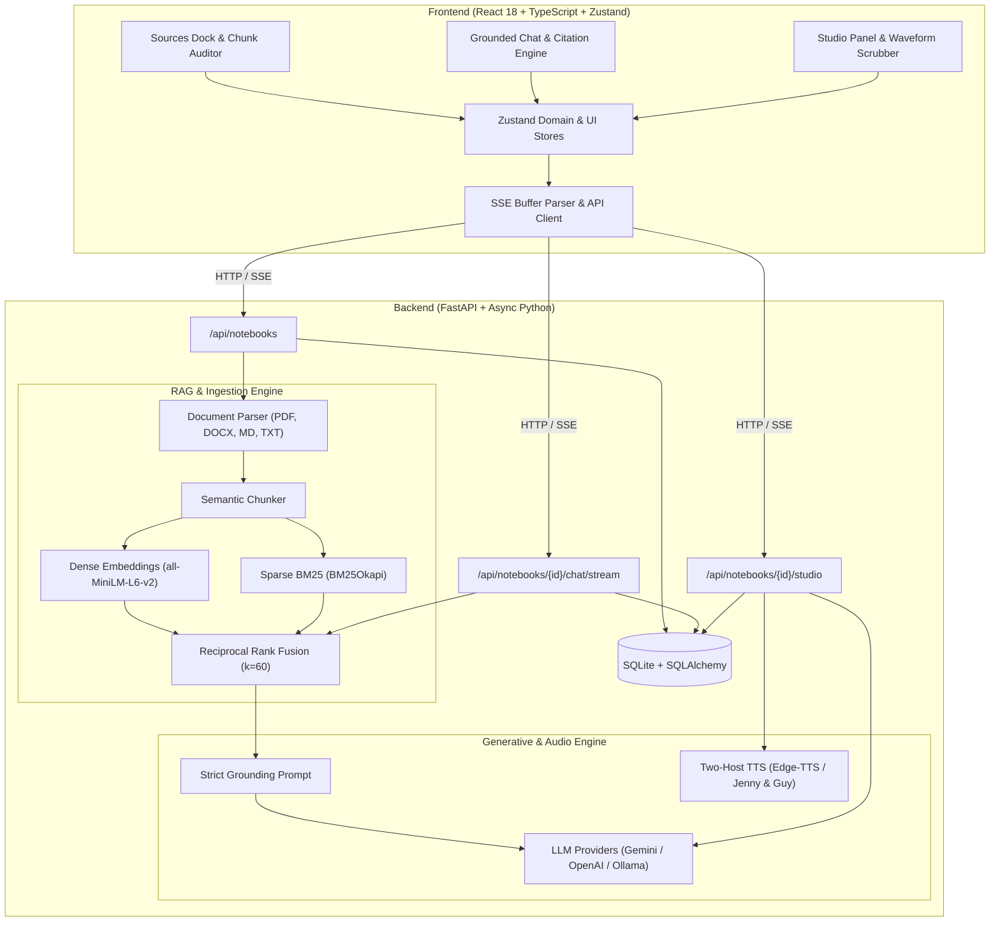

# NotebookLM-lite

> **A scholarly, source-grounded research notebook featuring dense-sparse hybrid search, streaming inline citations, studio artifact synthesis, and two-host audio overviews.**

NotebookLM-lite is an open-source, local-first alternative to Google NotebookLM. Designed for researchers, academics, students, and engineers, it prioritizes **strict factual grounding**, verifiable evidence links, and generative synthesis across multi-document corpora.

The application features a bespoke **"paper & ink"** scholarly aesthetic: warm dark ink (`#0C0C0B`) and tactile paper white (`#F4F0E4`), serif display typography (`Instrument Serif`), monospace metadata (`JetBrains Mono`), 1px hairline rules, a single chartreuse accent (`#D6FF3F`), and exactly two raised structural surfaces (`Composer` and `Audio Player`).

---

## Architecture Overview



---

## Key Features

### 1. Multi-Format Ingestion & Chunk Auditor
- **Supported Formats:** PDF (`pypdf` / `pdfplumber`), DOCX (`python-docx`), Markdown (`.md`), and raw text (`.txt` / pasted clipboard text).
- **Chunk Quality Auditor:** Real-time client-side auditing flagging empty chunks, oversized chunks (>800 tokens), duplicate chunks, and mid-sentence splits with health status badges.
- **Source Inspector:** Slide-out drawer with in-drawer substring search, token statistics, and instant chunk highlighting using `content-visibility: auto`.
- **Context Share Metrics:** Live token counting per source with visual context share bars indicating budget utilization.

### 2. Dual-Stage Hybrid Search & Strict Grounding
- **Dense Vector Search:** Semantic similarity search using `sentence-transformers` (`all-MiniLM-L6-v2`) or OpenAI / Gemini embeddings.
- **Sparse Keyword Search:** Exact keyword recall using `rank_bm25` (`BM25Okapi`).
- **Reciprocal Rank Fusion (RRF):** Blends dense and sparse rankings with smoothing parameter $k=60$:
  $$RRF\_Score(d) = \sum_{m \in M} \frac{1}{k + r_m(d)}$$
- **Hallucination Prevention:** The grounding prompt strictly confines LLM responses to indexed passages. Unverified claims outside the sources are rejected.

### 3. Streaming Chat & Grounded Citation Engine
- **Server-Sent Events (SSE):** Real-time token streaming with custom `SSEBufferParser` handling arbitrary network chunk boundaries.
- **`requestAnimationFrame` Batching:** Stream flushes run at 60fps without choking React render cycles.
- **Dynamic Citation Pills `[n]`:** Inline superscript brackets automatically resolve to cited chunks, featuring hover popovers (source filename, page number, and exact quote snippet) and a 600ms pulse animation on the cited source row when clicked.
- **Math & Code Rendering:** KaTeX mathematical typesetting (`trust: false` for security) and syntax-highlighted code blocks with one-click copy.
- **Raised Surface 1 (Composer):** Auto-growing textarea (1 to 8 rows) with active focus ring, live context tokens counter, and keyboard shortcuts (`Enter` send, `Shift+Enter` newline).

### 4. Generative Studio Panel & Audio Scrubber
- **Generative Artifacts (2x2 Grid):**
  - **Study Guide:** Core concepts, review quizzes, and structured glossary terms.
  - **Briefing Document:** Executive summary, key findings, and decision matrices.
  - **FAQ & Glossary:** Technical queries, definitions, and domain jargon.
  - **Timeline:** Chronological progression of arguments, milestones, or methodologies.
- **Manuscript Modal (`ArtifactViewer`):** Clean reading modal with copy, download as `.md`, and one-click save to notes.
- **Two-Host Grounded Podcast Synthesis:** Generates natural conversational dialogue between Host 1 and Host 2 grounded in the active corpus, synthesized via `edge-tts` (Jenny & Guy).
- **Raised Surface 2 (Audio Player):** 52-bar canvas waveform scrubber with pointer-capture drag-to-seek, hover time tooltips, transport controls (rewind 15s, forward 15s), and speed options (0.8x, 1x, 1.2x, 1.5x).
- **Personal Notes Workspace:** CRUD notes system with multi-note selection to synthesize new artifacts directly from user notes.
- **Full Archive Export:** Dynamic `fflate` compression generating a `.zip` archive containing `notebook.json`, `notes/*.md`, `artifacts/*.md`, and `chat_transcript.md` with academic footnotes.

### 5. Scholarly "Paper & Ink" Design System
- **Theme Modes:**
  - **Dark "Ink" Theme (`#0C0C0B`):** Warm charcoal canvas, hairlines, and luminous text (`#F2EEE2`).
  - **Light "Paper" Theme (`#F4F0E4`):** Warm tactile paper canvas with deep ink typography (`#14140F`).
  - **Zero Theme Flash:** Inline pre-paint script checks `localStorage` and system preference before DOM mount.
- **Accessibility:** 100% WCAG 2.2 AAA/AA compliance across all text pairs (Contrast ratios: 16.97:1 Dark, 15.84:1 Light, 16.99:1 Accent button).
- **Responsive Layout:**
  - **Desktop (>=1280px):** Full 3-pane layout (Sources dock, Grounded Chat reading column, Studio panel).
  - **Tablet (768px–1279px):** Collapsible Studio drawer (`Mod+J`) and Sources rail (`Mod+B`).
  - **Mobile (<768px):** Touch-friendly controls (>=40px targets), bottom-sheet panels, and responsive header.

---

## Project Structure

```text
NotebookLM-lite/
├── api/                             # FastAPI Backend
│   ├── main.py                      # Application factory & CORS middleware
│   ├── dependencies.py              # Database & session dependencies
│   ├── models/                      # SQLAlchemy ORM models
│   │   ├── notebook.py              # Notebook, Source, Chunk models
│   │   ├── chat.py                  # Thread, Message, Citation models
│   │   └── studio.py                # Note, Artifact, Audio models
│   ├── schemas/                     # Pydantic V2 request & response schemas
│   └── routers/                     # Endpoint controllers
│       ├── notebooks.py             # Notebook & Source CRUD
│       ├── chat.py                  # SSE Chat streaming & thread history
│       └── studio.py                # Artifact generation & audio synthesis
├── core/                            # Core Logic & Algorithms
│   ├── ingest/                      # Document parsers & chunking
│   │   ├── pdf_parser.py            # PDF text & coordinate extractor
│   │   ├── docx_parser.py           # DOCX reader
│   │   └── chunker.py               # Semantic chunking strategy
│   ├── search/                      # Retrieval-Augmented Generation
│   │   ├── dense_search.py          # Sentence-Transformers vector index
│   │   ├── sparse_search.py         # BM25Okapi keyword index
│   │   └── hybrid_search.py         # Reciprocal Rank Fusion (RRF)
│   ├── grounding/                   # Citation & Hallucination Prevention
│   │   ├── prompt_templates.py      # Strict scholarly grounding prompts
│   │   └── citation_extractor.py    # Inline bracket [n] citation resolver
│   └── audio/                       # Audio Overview & Podcast Synthesis
│       ├── dialogue_generator.py    # Two-host conversational script generator
│       └── tts_engine.py            # Edge-TTS multi-voice audio synthesis
├── storage/                         # Local persistence directory
│   ├── uploads/                     # Uploaded PDF, DOCX, TXT documents
│   ├── audio/                       # Synthesized MP3 podcast episodes
│   └── vector_store/                # Persisted dense embedding arrays
├── tests/                           # Backend Pytest Suite
│   ├── test_ingest_and_chunks.py    # Document parsing & chunking tests
│   ├── test_hybrid_search.py        # Dense + Sparse + RRF tests
│   ├── test_grounded_citations.py   # Grounding prompt & citation resolution
│   ├── test_api_endpoints.py        # FastAPI HTTP & SSE stream tests
│   └── test_studio_and_audio.py     # Artifacts & Audio generation tests
├── frontend/                        # React 18 + TypeScript + Vite Frontend
│   ├── src/
│   │   ├── api/                     # Typed client & SSE buffer parser
│   │   │   ├── client.ts            # REST API client
│   │   │   ├── sse.ts               # SSE stream consumer with boundary buffer
│   │   │   └── mock.ts              # Offline fallback adapter
│   │   ├── components/              # UI Components
│   │   │   ├── ui/                  # Primitives (Button, Tabs, Popover, etc.)
│   │   │   ├── Header.tsx           # Logo, title switcher, model & theme controls
│   │   │   ├── SourcesPanel.tsx     # Sources dock & drag-and-drop dropzone
│   │   │   ├── SourceRow.tsx        # Source item with context share bar
│   │   │   ├── SourceInspector.tsx  # Drawer for chunk auditing & search
│   │   │   ├── ChatPanel.tsx        # Reading column & empty state starters
│   │   │   ├── Composer.tsx         # Raised Surface 1 with auto-grow & token pills
│   │   │   ├── MessageList.tsx      # Memoized turns with serif italic styling
│   │   │   ├── MarkdownRenderer.tsx # Markstream parser with KaTeX math
│   │   │   ├── CitationPill.tsx     # Hover popover & row pulse trigger
│   │   │   ├── StudioPanel.tsx      # Compound tabs & artifact grid
│   │   │   ├── AudioPlayer.tsx      # Raised Surface 2 with 52-bar canvas waveform
│   │   │   ├── ArtifactTile.tsx     # 2x2 grid tile with dynamic glyphs
│   │   │   ├── ArtifactViewer.tsx   # Manuscript view modal
│   │   │   ├── NotesPanel.tsx       # Personal research notes CRUD
│   │   │   └── ExportNotebookButton.tsx # fflate zip export handler
│   │   ├── hooks/                   # Custom Hooks (useHotkeys, useStream, useAudioPlayer)
│   │   ├── store/                   # Versioned Zustand Stores (notebookStore, uiPrefsStore)
│   │   ├── styles/                  # Design Tokens & Craft Stylesheets
│   │   │   ├── tokens.css           # Paper & ink color tokens, radii, z-index
│   │   │   └── base.css             # Typography, SVG grain, custom scrollbar
│   │   ├── test/                    # Vitest Frontend Test Suites (47 tests)
│   │   ├── types.ts                 # Branded IDs & Discriminated Unions
│   │   └── App.tsx                  # 3-Pane Application Shell
│   ├── index.html                   # HTML entrypoint with pre-paint theme script
│   ├── vite.config.ts               # Vite bundler configuration & KaTeX vendor splitting
│   └── package.json                 # Frontend dependencies
├── .env.example                     # Environment configuration template
└── README.md                        # Documentation
```

---

## Getting Started

### Prerequisites
- **Python:** 3.11 or later
- **Node.js:** 18.0.0 or later
- **Package Managers:** `pip` / `uv` for Python, `npm` for Node.js
- *(Optional)* Gemini API Key (recommended) or OpenAI API Key or local Ollama instance

---

### 1. Backend Setup

1. **Clone the repository:**
   ```bash
   git clone https://github.com/RajatSharma404/NotebookLM-lite.git
   cd NotebookLM-lite
   ```

2. **Create and activate a virtual environment:**
   ```bash
   python -m venv .venv
   # Windows PowerShell:
   .venv\Scripts\Activate.ps1
   # Linux / macOS:
   source .venv/bin/activate
   ```

3. **Install dependencies:**
   ```bash
   pip install -r requirements.txt
   ```

4. **Configure Environment Variables:**
   ```bash
   cp .env.example .env
   ```
   Open `.env` and configure your API keys:
   ```ini
   # Model Providers (gemini | openai | anthropic | ollama)
   DEFAULT_LLM_PROVIDER=gemini
   GEMINI_API_KEY=your_gemini_api_key_here

   # Embeddings (sentence_transformers | openai | gemini)
   EMBEDDING_PROVIDER=sentence_transformers
   EMBEDDING_MODEL_NAME=all-MiniLM-L6-v2

   # Audio Overview TTS (edge-tts)
   TTS_ENGINE=edge-tts
   TTS_VOICE_SPEAKER_A=en-US-GuyNeural
   TTS_VOICE_SPEAKER_B=en-US-JennyNeural
   ```

5. **Run the Backend Server:**
   ```bash
   uvicorn api.main:app --reload --port 8000
   ```
   The FastAPI server will be available at `http://127.0.0.1:8000`. Interactive OpenAPI documentation is accessible at `http://127.0.0.1:8000/docs`.

---

### 2. Frontend Setup

1. **Navigate to the frontend directory:**
   ```bash
   cd frontend
   ```

2. **Install frontend dependencies:**
   ```bash
   npm install
   ```

3. **Start the Vite development server:**
   ```bash
   npm run dev
   ```
   The application will be live at `http://127.0.0.1:5173`. The development server automatically proxies API requests to `http://127.0.0.1:8000`.

---

## Running Tests

### Backend Test Suite (Pytest)
From the project root:
```bash
pytest -v
```
Covers:
- Document extraction and chunk boundary invariants
- Hybrid search (BM25 + Dense + RRF) recall
- Grounding prompt formatting and citation resolution
- REST endpoints and SSE streaming protocols
- Studio artifact generation and TTS audio synthesis

### Frontend Test Suite (Vitest)
From the `frontend/` directory:
```bash
npm test -- --run
```
Covers:
- **`sanitize.test.ts`:** Filename cleanup, middle-ellipsis, URL protocol whitelist
- **`sse.test.ts`:** `SSEBufferParser` chunk boundary handling and event parsing
- **`store.test.ts`:** Zustand store schema migration, persistence, and optimistic state
- **`shell.test.tsx`:** Keyboard shortcuts (`Mod+B`, `Mod+J`, `Escape`), header controls, theme switching
- **`sources.test.tsx`:** Drag-and-drop upload, context share bars, Chunk Auditor quality badges
- **`chat.test.tsx`:** Streaming tokens, citation pill hover/clicks, full XSS corpus defense, KaTeX math parsing
- **`studio.test.tsx`:** Waveform hit-test math (`seekFromPointer`), artifact tiles, note CRUD and synthesis

### Typecheck & Production Build
```bash
# Verify TypeScript strict types (0 errors)
npm run typecheck

# Build production bundle with vendor splitting
npm run build
```

---

## Keyboard Shortcuts

| Shortcut | Description |
|---|---|
| `Mod + B` (`Ctrl+B` / `Cmd+B`) | Toggle Sources Dock open/collapsed |
| `Mod + J` (`Ctrl+J` / `Cmd+J`) | Toggle Studio Panel open/collapsed |
| `Mod + /` (`Ctrl+/` / `Cmd+/`) | Focus Grounded Chat Composer |
| `Escape` | Close open Inspector drawer, Manuscript modal, or Popover |
| `Enter` | Send message in Composer |
| `Shift + Enter` | Insert newline in Composer |

---

## License

This project is licensed under the MIT License. See [LICENSE](LICENSE) for details.